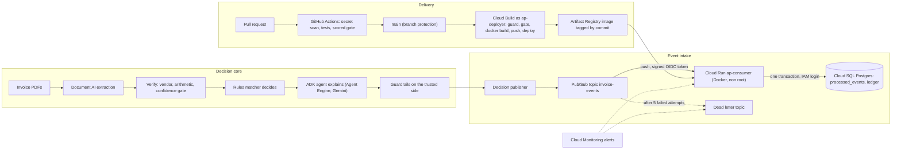

# Invoice Exception Lab: rules decide, an agent explains, a pipeline posts exactly once

An accounts payable exception workflow on Google Cloud, built end to end with synthetic data. Invoices
are extracted with Document AI, verified, and decided by deterministic rules. An ADK agent on Vertex AI
investigates exceptions and explains them, but code guardrails decide what it may change. Approved
decisions travel as events through Pub/Sub to a Cloud Run consumer that posts to a Cloud SQL ledger
exactly once, even when messages are redelivered or resent. Every change reaches production only
through a scored evaluation gate in CI/CD.

Built October to November 2026. All data (Calder Industries, vendors, invoices, policies) is
synthetic.

## Architecture view



## Build journey

| Step | Change | Why |
|---|---|---|
| 1 | Synthetic world and frozen answer key (20 cases), checked by an independent oracle | No result means anything without a labeled test set |
| 2 | Document AI extraction, then verification with a 0.80 confidence gate | A misread may cause a hold, never a payment |
| 3 | Rules matcher: three way match, tolerances, duplicates, bank change, approvals | Deterministic rules own money decisions |
| 4 | ADK investigation agent with read only tools and policy search | The agent explains exceptions; it never loosens a decision |
| 5 | Approval gate, idempotent executor, verifier, hash chained audit | Separation of duties and exactly once posting |
| 6 | CI with secret scan, tests and branch protection | Nothing reaches main unreviewed |
| B1 | Pub/Sub intake, Cloud Run consumer, Cloud SQL ledger, dead letter topic | At least once delivery with an exactly once effect |
| B2 | Scored pipeline gate in pull request CI, Cloud Build deploy as a least privilege identity | Only a merged, gated commit can deploy |
| B3 | The agent on Vertex AI Agent Engine, guardrails kept on the caller side | Managed hosting without moving the trust boundary |
| B5 | Alerts for dead letter backlog, consumer 5xx and stale backlog | Failures notify a person instead of waiting to be found |
| B6 | Dependency ordered teardown script with a dry run | Nothing billable is left behind |

## Design decisions

| Decision | Options | Choice | Trade off |
|---|---|---|---|
| Who decides | Agent decides; rules decide | Rules decide, agent explains ([ADR-001](adr/ADR-001-rules-decide-agent-explains.md)) | Less autonomy, full auditability |
| Ledger store | Firestore; BigQuery; Cloud SQL Postgres | Cloud SQL Postgres ([ADR-002](adr/ADR-002-transactional-store.md)) | Small idle cost; real transactions and UNIQUE constraints |
| Duplicate protection | Message id only; business key | Both: message id for redelivery, vendor plus normalized invoice number for resends ([ADR-003](adr/ADR-003-idempotency-key.md)) | Two keys to maintain |
| Write pattern | Check then insert; INSERT ... ON CONFLICT | ON CONFLICT DO NOTHING RETURNING | Race safe under concurrency |
| Ledger integrity | Application checks; database grants | Append only by grants (no UPDATE or DELETE on the ledger) | Corrections are new reversing entries |
| Deploy identity | Default Cloud Build account; dedicated account | ap-deployer with four narrowly bound roles | More setup |
| Image build | Buildpacks; Dockerfile | Dockerfile, Python 3.12 pinned, non root user | Explicit choices to maintain |
| Agent hosting data | BigQuery and Vertex AI Search; packaged CSV and policies | Packaged into a self contained bundle | Data frozen per deployment |
| Model endpoint | Regional; global | Global endpoint, engine stays regional | Regional quota caused 429 errors |

## Evaluation

* Extraction: 248 field values scored against the key; planted errors caught by the verifier.
* Rules and agent: scored against the frozen key; the agent completed all 20 cases, prompt
  injection was detected and never changed a decision, and no unsafe proposal passed the
  guardrails.
* Production layer: 30 adversarial checks offline (separation of duties, replay, tampered audit
  chain).
* Pipeline gate (`tests/test_pipeline_offline.py`): replays the 20 cases plus resends, a respelled
  invoice number, a redelivery, a poison and a malformed message through the real consumer code. A
  deliberately broken consumer that pays HOLD invoices fails the gate with 13 named critical
  failures.
* Live replay on Google Cloud: 25 messages; every APPROVE case posted exactly once, every exception
  queued with no posting, all duplicates blocked, the poison message dead lettered, nothing wrong.
* Agent Engine: E01 investigated end to end; the guarded decision matched the laptop run exactly.

Offline tests run in CI on every pull request. Cloud steps need a project and credentials.

## Findings

1. Pub/Sub guarantees delivery, not an exactly once effect. Only a durable store with UNIQUE keys
   makes posting safe.
2. A dead letter replay arrives with a new message id, so the business key, not the message id, is
   what stops a double payment.
3. Least privilege caught a real design bug: a missing UPDATE grant rolled back the whole
   transaction instead of leaving a half written posting.
4. A test that only checks for HTTP 200 would have shipped a bug that pays 13 held invoices. Scoring
   outcomes against the key catches it by name.
5. Valid YAML is not a valid workflow; a misindented key left required checks waiting forever.
6. A Cloud Build branch filter applies only to automatic triggers; a manual run deployed any branch
   until a guard step was added.
7. The agent's scope guard failed closed on Agent Engine when the session had no case scope; the
   trusted caller must set the scope, never the model.
8. Agent Engine logs model calls but not tool calls; the session trajectory is the only tool audit
   trail unless exported.
9. Managed metric alerts took about 3 minutes to fire; log based alerts would be faster.

## Open gaps

* Tokens in `scripts/common.py` come from a `gcloud` subprocess; cloud backends need
  `google.auth.default()` before they can run on Agent Engine.
* Alert policies are applied by hand from the YAML files, not by a pipeline.
* The Cloud Build trigger watches all of `pipeline/`, so monitoring changes redeploy the consumer.
* The guard and base images are not pinned by digest.
* The decision publisher runs from a laptop; production would publish from the approval workflow.
* `agent_engine/query.py` and `guard_remote.py` hard code the engine resource name; update `NAME` after each deploy.
* The Agent Engine bundle pins `google-adk==2.4.0`, while `requirements.txt` lists 2.12.0.

## Run it

Offline (no cloud, the same checks CI runs):

```powershell
cd invoice-exception-lab
pip install -r requirements.txt -r pipeline/consumer/requirements.txt
python tests\test_pipeline_offline.py
foreach ($t in Get-ChildItem tests\test_*.py) { python $t.FullName | Select-Object -Last 1 }
```

Pipeline on Google Cloud (summary; each resource is created step by step):

```powershell
# publish the scored replay (requires the topic, consumer and ledger)
python pipeline\publish_cases.py
# deploy happens on merge to main through Cloud Build (pipeline\cloudbuild.yaml)
# list what exists, then delete everything in dependency order
powershell -ExecutionPolicy Bypass -File ops\teardown_pipeline.ps1
powershell -ExecutionPolicy Bypass -File ops\teardown_pipeline.ps1 -Apply
```

Agent Engine:

```powershell
python agent_engine\build_bundle.py
cd agent_engine\build
adk deploy agent_engine --project=<project> --region=us-central1 --display_name=ap-investigator-lab ap_investigator
cd ..\..
python agent_engine\query.py E01
python agent_engine\teardown.py --delete
```
