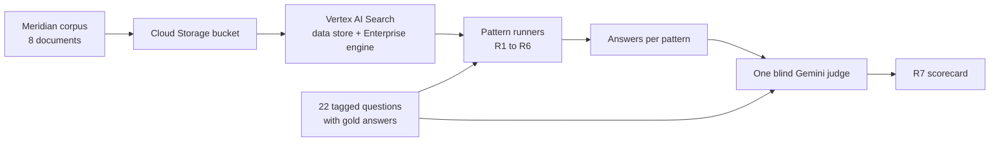
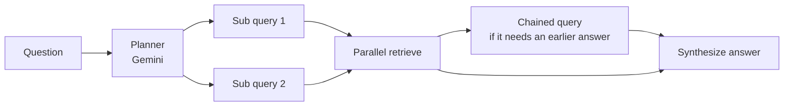
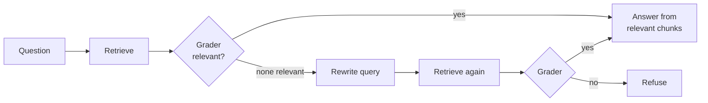
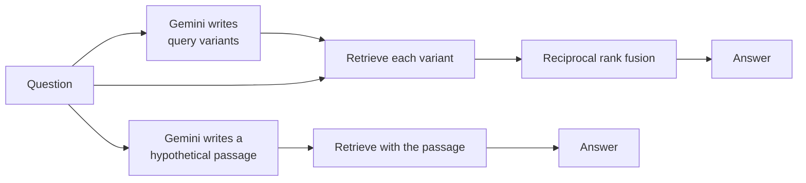
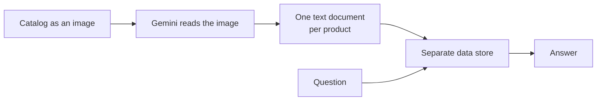
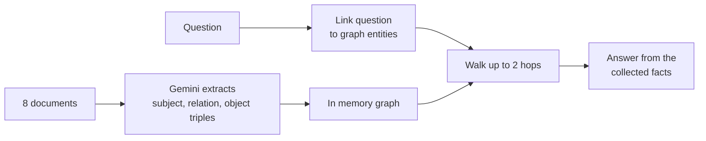
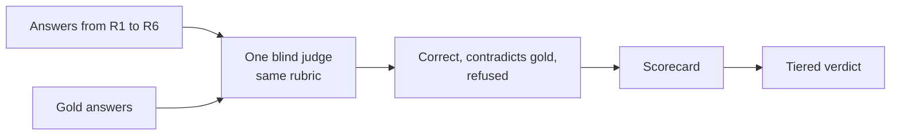

# Meridian RAG Lab

Six retrieval augmented generation patterns on Google Cloud, run on one synthetic
corpus and scored head to head against a naive baseline. The point is to learn when each
pattern earns its cost, so a flat or negative result is a valid finding.

## What was built

- **Corpus.** A synthetic appliance company, Meridian, with 8 documents. Each carries
  planted stress points: a spec table, a multi hop chain, policy rules, and facts that
  are deliberately missing.
- **Questions.** 22 tagged questions with gold answers. 19 are answerable and 3 are not,
  so refusal is measured. Each question targets a failure mode, with easy controls mixed in.
- **Stack.** Vertex AI Search (data store plus Enterprise engine) for retrieval, Gemini on
  Vertex for planning, grading, extraction, synthesis and judging, plain REST from Python.

## Architecture



## The patterns

| id | pattern | idea | what it adds over naive |
|---|---|---|---|
| R1 | Naive | One search, managed summary | the baseline |
| R2 | Agentic | Plan sub queries, parallel and chained retrieve | completeness on multi part questions |
| R3 | Corrective | Grade chunks, rewrite and retry once | refusal safety |
| R4 | Fusion and HyDE | Query variants with rank fusion, or a hypothetical passage | recall on vague wording |
| R5 | Multimodal | Read the catalog image into per product text | tables |
| R6 | Graph | Triples in a graph, link entities, walk 2 hops | connected facts |

### R2 Agentic, plan then fan out




### R3 Corrective, grade before answering




### R4 Fusion and HyDE, change the query




### R5 Multimodal, make tables searchable




### R6 Graph, walk connected facts




### R7 Scorecard



## Results

A single blind Gemini judge scored every final answer against the gold answer. Good means
correct and not contradicting the gold answer. R5 ran only on its 5 questions. R4 baseline is
R1's retrieval with the same Gemini answer step the other patterns use, so it is the fair
control for R2 to R6.

| pattern | good on answerable | false refusals | correct refusals |
|---|---|---|---|
| R1 naive | 10/19 | 6 | 3/3 |
| R2 agentic | 12/19 | 6 | 3/3 |
| R3 corrective | 11/19 | 5 | 3/3 |
| R4 baseline (same generator control) | 13/19 | 6 | 3/3 |
| R4 fusion | 16/19 | 3 | 3/3 |
| R4 HyDE | 13/19 | 6 | 3/3 |
| R5 vision | 4/4 | 0 | 1/1 |
| R6 graph | 12/19 | 5 | 3/3 |

Retrieval hit (does a gold document appear in the results) was 15 of 19 for R1 to R4, and
18 of 19 for R6.

### Findings

- **The answer generator matters as much as most patterns.** R1 uses the managed summary and
  scored 10 of 19. The same retrieval with a Gemini answer step (the R4 baseline) scored 13 of
  19. Compare R2 to R6 with the 13, not the 10.
- **Only fusion beat the fair baseline on general questions.** Fusion scored 16 of 19 and
  rescued a table question and two others. Agentic (12), corrective (11) and HyDE (13) did
  not beat the baseline, and graph (12 overall) beat it only on its own question type.
- **Structure beats raw text for tables.** Splitting the catalog into per product text took
  table questions from 0 of 3 to 3 of 3 (R5 and R6). Reading the image added nothing over
  plain code that did the same split. Vision pays only when no clean text exists, such as a scan.
- **Retrieval hit hides answer quality.** R1 hit the gold document on 15 of 19 questions but
  produced a good answer on only 10.
- **Graph wins its own type and loses on prose.** 4 of 4 on entity and multi hop questions,
  but 2 of 5 on plain policy questions. The production shape is hybrid, text for passages and a
  graph for connected facts.
- **Corrective RAG did not pay here.** Every pattern already refused all 3 unanswerable
  questions, and the grader dropped needed chunks on several questions.
- **Agentic added no recall.** The planner split only 4 of 22 questions.

Tiers: worth the cost are fusion, the structure fix for tables, and a graph for connected
facts. Not worth it on this corpus are agentic, corrective and HyDE.

### Caveats

- 19 answerable questions is a small sample, so a gap of one or two is noise. Read the tiers,
  not the exact ranks.
- The generator confound is handled by the R4 baseline control, but R1 itself is not
  comparable to R2 to R6 without it.
- Grounding is not scored, because retrieved text was not stored for R1 to R5. Contradiction
  with the gold answer is the hallucination proxy.
- Latency and cost are not measured. Design based call counts per question: R1 one search,
  R2 about 3 Gemini calls, R3 about 3.4, R4 fusion 4 searches and 2 Gemini calls, R6 two
  Gemini calls and no search.
- The judge is itself a model. A hand check of sampled verdicts matched, but it was a small sample.

## Lessons

- Gemini 3.x flash is a reasoning model. Thinking tokens count against the output budget, so a
  small budget silently truncates JSON. Use 2048 or more for structured calls, retry larger,
  and record every failure. This invalidated one early result, which was caught and rerun.
- Never let a fallback fail silently. Planner, grader and entity linking each fell back
  quietly at first, and the fix was to record the error and the fallback flag on every row.
- Resume from the results file, refresh the access token per question, and back off on 429.

## Gaps and next steps

- A hybrid pattern, text retrieval plus graph, scored on the same questions.
- Run on real SAP data (structured and unstructured) for scale, permissions, freshness and
  evaluation without gold answers. Synthetic data cannot show those.

## Reproduce

Each pattern folder has a runner that reads `rag-lab/r0-foundation/questions.jsonl` and writes
a results file. Authenticate with `gcloud auth login`, set the project, then run for example:

```
python rag-r1-naive/query_naive.py
python rag-r4-fusion-hyde/query_fusion_hyde.py
python rag-r6-graph/extract_graph.py
python rag-r6-graph/query_graph.py
python rag-r7-scorecard/judge_scorecard.py
```
